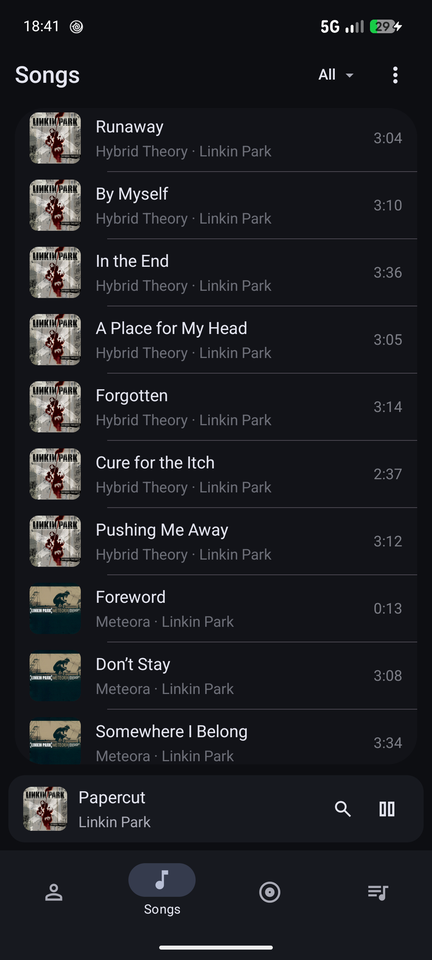
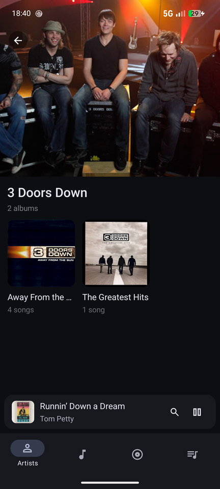
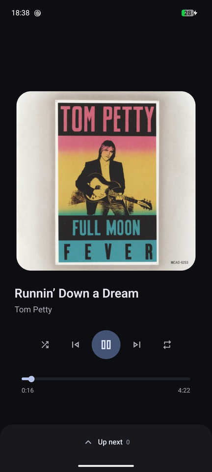

# Zest Music

A local-first music player for Android. It scans granted folders, keeps the library in SQLite, and
plays the files through `react-native-audio-api` with background playback and a system media
notification.

Zest Music is inspired by Vanilla Music. It targets a native Android interface and covers workflow
details such as the action for tapping the currently playing song, one-handed controls (including
left-handed use), and playing another song without losing the current queue. The roadmap lists
planned work.

Audio files and the SQLite database stay on-device; no account is required. When an artist has
no MusicBrainz ID, artwork lookup sends its name to MusicBrainz to find one, then uses the ID with
Wikidata to find an image on Wikimedia Commons. If enabled, Deezer also receives the artist name
for fallback lookup.

## Screenshots

|        |  |  |
| :------------------------------------------: | :--------------------------------------: | :-------------------------------------------: |
| **Songs** — mode and album filters, play all |    **Artist** — hero, albums, counts     |       **Now playing** — queue and seek        |

## What works today

- Grant music folders through Android's SAF picker, then scan tags into SQLite
- Rescans skip files whose size and modification time did not change, and drop songs whose files
  are gone while keeping the playing track on screen until playback moves on
- Scanner recognizes AAC, AIFF, APE, ASF, CAF, DSD (DFF/DSF), FLAC, M4A/M4B, MP1/2/3, MP4,
  Musepack (MPC/MPP), Ogg-family (OGA/OGG/Opus/Speex), WAV, WMA and WavPack. Playback depends on
  Android native decoder support.
- Artists, Albums and Songs tabs with an All / Recent / Most played dropdown driven by persisted
  play counts
- Song long-press menu: add to a playlist, enqueue, play next, or play now
- Playlists tab: create a playlist, add songs from the song long-press menu, open one to play it,
  remove songs by long-pressing them, and long-press a playlist to delete it
- Tapping an album anywhere filters the Songs tab behind a dismissible chip
- Artist page with an edge-to-edge hero image, album carousel and library counts
- Search overlay opened from the mini player, with an Artists / Songs / Albums switch that starts on
  the current tab
- Full player: cover, play/pause, previous/next, shuffle, repeat one/all, seek bar with long-press
  fine scrubbing, an up-next sheet, and tappable artist and album links
- Mini player with search, play/pause and expand: an upward swipe grows it into the full player,
  which closes only on a downward swipe
- Background playback with a media notification (play/pause, next/previous, scrubber); playback
  pauses when the last wired, USB or Bluetooth output disappears
- Settings: what tapping the current song does, artist image source, music folders
- Material 3 palette in light and dark, following the system setting

## Stack

- Expo SDK 58, React Native 0.88, React 19, TypeScript
- Expo Router with native bottom tabs
- NativeWind 4 for styling, `react-native-reanimated` 4 for gestures and transitions
- `expo-sqlite` with Drizzle ORM; migrations applied at boot
- `react-native-audio-api` for playback, a JSI module, so the app needs a dev build
- `music-metadata` and `strtok3` for tags, `expo-image` for artwork, `zod` for persisted shapes

## Playback

Selecting a song passes its URI from the screen to `AudioProvider` and the singleton `audioEngine`.
An Android SAF `content://` URI is opened as a file descriptor by the `saf-file-descriptor` module
and played from `/proc/self/fd/<fd>`. `StreamingAudio` then mounts the `Audio` component from
`react-native-audio-api` with the resulting source and the shared `AudioContext`.

The native file source only accepts filesystem paths, so the engine probes the descriptor before
use and reads from it when it is playable. Providers that cannot expose a playable descriptor fall
back to one full copy into the app cache. Before descriptor playback, every `content://` URI was
copied into the cache before it played: the first tap on a track waited for a full copy, and each
played track briefly existed twice on disk.

The signal path is:

```
SAF URI -> /proc/self/fd/<fd> (or a cached copy when the descriptor is unplayable)
        -> native file source -> MediaElementSource
        -> BiquadFilterNode (gain 0 dB) -> AudioContext.destination -> device output
```

The native module decodes and plays the file. The filter is currently neutral, so it does not
change the sound; it is in the graph to support a future equalizer. Queue, shuffle order, repeat
mode and position persist so playback can be restored after a restart.

Audio focus is requested when a track starts and released when playback stops or errors. A route
change or a dead native output stream is recovered by resuming the `AudioContext`. Losing the last
external output pauses playback; connecting a device leaves playback running and routes the stream
to the new device.

## Data

- Tables: `artists`, `releases`, `songs`, `playlists` and the `song_playlists` join table. Songs
  carry duration, track number, play count and last played at.
- Playlists are many-to-many through `song_playlists`. Adding a song is idempotent — the composite
  primary key drops the duplicate and the UI reports “Already in …” instead of reordering. The app
  enables `PRAGMA foreign_keys = ON` on its connection so deleting a song or playlist removes its
  associations; SQLite leaves foreign keys off by default, which is why `purgeOrphanedRows` still
  deletes releases and artists by hand.
- Inserts go through `src/db/library.ts`, which upserts artists and releases by MusicBrainz ID.
- Scanning is split by responsibility: the folder walk (`musicScan`), metadata and row building
  (`musicIndexer`) and upserts (`db/library`) are separate, and `MusicLocationContext` only
  publishes scan state.
- Play statistics are written once per actual playback and read through a small module store;
  ranking does not query the database.

## Structure

| Path                 | Contents                                                                                                   |
| -------------------- | ---------------------------------------------------------------------------------------------------------- |
| `modules/`           | `saf-file-descriptor`: Kotlin + TS module that opens SAF URIs as fds                                       |
| `patches/`           | `react-native-audio-api` patch so descriptor paths decode                                                  |
| `src/app/`           | Expo Router routes: tabs, artist and playlist stacks, settings                                             |
| `src/audio/`         | engine with descriptor and cache sources, provider, queue, notifications                                   |
| `src/babel-plugins/` | Hermes compatibility transform for `file-type`                                                             |
| `src/components/`    | list rows, players, playlist picker and dialogs, snackbar, filter dropdown, tab menu, search, action sheet |
| `src/context/`       | library scan state and tab bar state                                                                       |
| `src/db/`            | Drizzle schema, select schemas, library upserts and playlist helpers                                       |
| `src/hooks/`         | theme, preferences, artist images, audio, library and playlist accessors                                   |
| `src/lib/`           | scan/index helpers, saved locations, stats, artist images, layout                                          |
| `src/theme/`         | MD3 tokens for spacing, type and radius, mapped into tailwind                                              |
| `src/types/`         | zod schemas and shared types                                                                               |
| `drizzle/`           | generated SQLite migrations                                                                                |

## Run locally

Requires Node and a dev build; Expo Go will not run this app.

```bash
npm install
npx expo run:android
npx expo start -c    # after adding routes or changing tailwind classes
```

## Scope

- Tag editing is out of scope; tags are prepared externally with MusicBrainz Picard before scanning.
- The scanner reads embedded MusicBrainz IDs, falls back to tag names and never modifies files.
- Missing metadata displays as `Unknown Artist` / `Unknown Album`.

## Known gaps

- Playlists cannot be renamed from the UI yet
- Playlist order is insertion order; there is no reordering
- The equalizer graph is wired but flat
- Album artwork is fetched per release without deduplication, and list rows render full-size covers
  instead of thumbnails

## Roadmap

- Playlist editing: rename playlists and drag to reorder their songs
- Add a whole album or playlist to a playlist instead of adding songs one at a time
- Add an add-to-playlist action to the full player's top-right controls
- Insights: a top-right menu item listing rarely played albums and songs
- Show lyrics on the expanded player, with a poppable floating window
- Normalise and group genre tags without a recommendation engine
- Add a left-handed layout preference that moves action buttons toward the bottom-left
- Add haptic feedback when entering granular seek mode and at other appropriate interactions
- Export playback statistics in an analysis-friendly format for pandas
- Stream music from a user-selected cloud provider, such as Google Drive
- Resume an interrupted scan instead of restarting the folder

## Licence

Apache-2.0. See [LICENSE](LICENSE).
